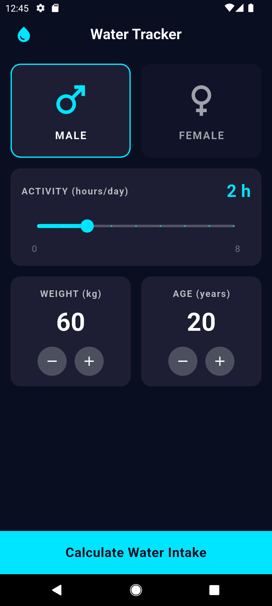
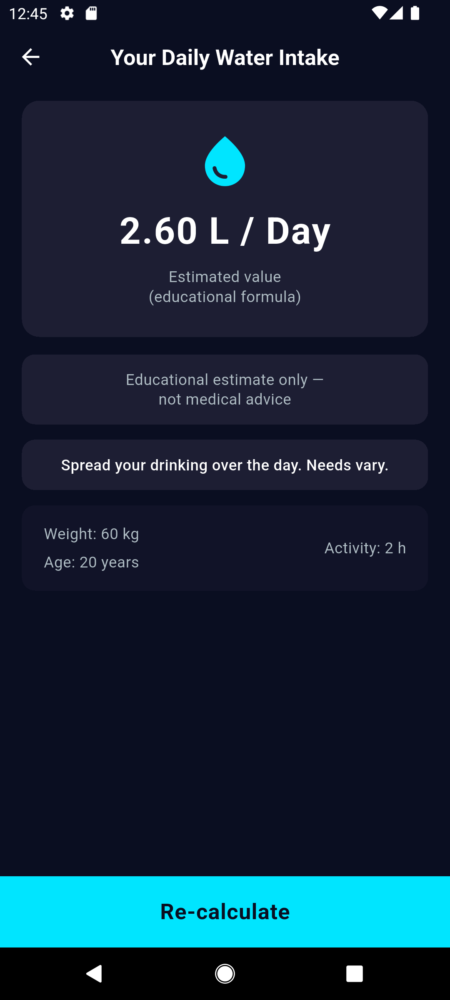

# Daily Water & Hydration Tracker App 💧

A Flutter application built with a dark theme to help users estimate their daily water intake based on their weight and daily activity level.

---

## 📱 Features

- **Dark Theme UI**: Clean, modern dark aesthetic following the specified design palette (`#0A0E21`, `#1D1E33`, `#111328`, `#00E5FF`).
- **Interactive Input Screen**:
  - Gender selection (Male / Female) with active highlight borders.
  - Daily Activity Slider ranging from 0 to 8 hours.
  - Interactive Counter Cards for Weight (30 - 200 kg) and Age (10 - 100 years).
- **Result Screen**:
  - Prominent display of estimated daily water intake in Litres/Day (`X.XX L / Day`).
  - Educational disclaimer clarifying that results are for educational purposes.
  - Dynamic guidance text tailored to the calculation result.
  - Summary of user inputs (Weight, Age, Activity).
  - Re-calculate button to smoothly navigate back.

---

## 📸 Screenshots

| Input Screen | Result Screen |
| :---: | :---: |
|  |  |

---

## 📐 Calculation Formula

The application uses an educational formula to estimate daily water requirement:

$$\text{baseMl} = \text{weightKg} \times 35$$
$$\text{activityMl} = \text{activityHours} \times 250$$
$$\text{totalLitres} = \frac{\text{baseMl} + \text{activityMl}}{1000}$$

---

## 🧩 Widgets & Architecture

- **Layout & Structure**: `MaterialApp`, `Scaffold`, `AppBar`, `Column`, `Row`, `Expanded`, `SingleChildScrollView`, `Padding`, `SizedBox`
- **User Input & Interaction**: `Slider`, `InkWell`, `GestureDetector`, custom `GenderCard`, custom `CounterCard`, `BottomButton`
- **Navigation**: `Navigator.push` and `Navigator.pop`
- **State Management**: `StatefulWidget` with `setState()` for dynamic local UI updates.

---

## 🚀 Getting Started

1. Ensure Flutter SDK is installed on your machine.
2. Clone the repository:
   ```bash
   git clone https://github.com/a7mdabdoo/water_hydration.git
   ```
3. Navigate to the project directory:
   ```bash
   cd water_hydration
   ```
4. Install dependencies:
   ```bash
   flutter pub get
   ```
5. Run the app:
   ```bash
   flutter run
   ```
